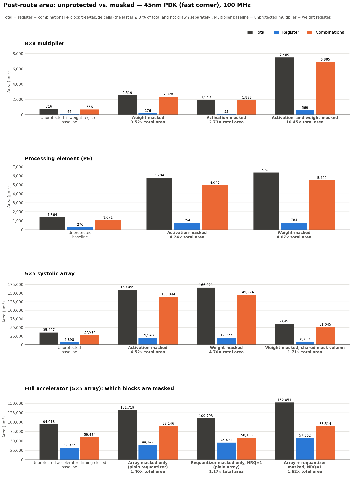
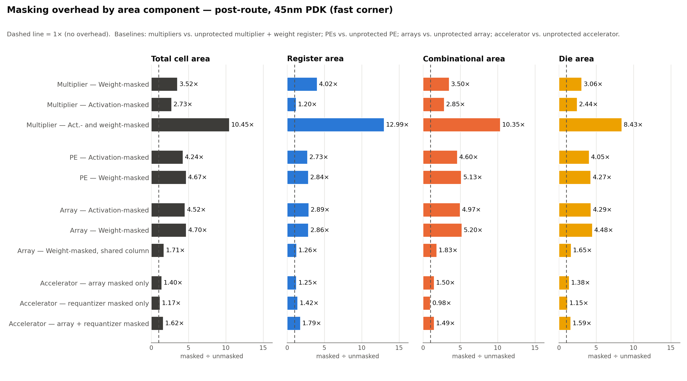

# Area Overhead of Arithmetic Masking — Post-Route Analysis

**Technology:** 45nm PDK — Cadence GPDK045 (`gsclib045`), from `45_nm_PDK/cadence/cadence_45nm/`
**Corner:** implemented and timed in the **fast** library (`fast_vdd1v0`, 1.1 V, 0 °C), the corner the lab Genus/Innovus flow uses; a second OpenSTA check runs in the **slow** library (`slow_vdd1v0`, 0.9 V, 125 °C)
**Flow:** Yosys 0.69+75 → OpenROAD 26Q3-2361 (floorplan → place → CTS → global/detailed route) → OpenSTA 3.1.0
**Clock:** 100 MHz (10 ns) — quick timing sanity check only
**Metric:** post-route area (µm²): total standard-cell area, split into register
(flip-flop) and combinational area, plus total die area. Power is out of scope.

---

## 1. Summary

**Area definitions** (all post-route; filler cells excluded):
- **Register:** flip-flops.
- **Combinational:** every logic cell that is not a flip-flop, including buffers
  and inverters.
- **Total:** register + combinational + clock-tree and tie cells. This is the
  full standard-cell area of the routed design.
- **Die:** full chip footprint at the common 50 % utilisation target.

| Level | Unmasked total (µm²) | Masked total (µm²) | **Total ×** | Register (µm²) unmasked → masked | **Register ×** | Combinational (µm²) unmasked → masked | **Comb. ×** | Die (µm²) unmasked → masked | **Die ×** |
|---|---:|---:|---:|---:|---:|---:|---:|---:|---:|
| 8×8 multiplier — activation-masked ¹ | 716.5 | 1,959.7 | **2.73×** | 43.8 → 52.7 | **1.20×** | 665.5 → 1,898.1 | **2.85×** | 1,736 → 4,230 | **2.44×** |
| 8×8 multiplier — weight-masked ¹ | 716.5 | 2,518.8 | **3.52×** | 43.8 → 176.1 | **4.02×** | 665.5 → 2,327.7 | **3.50×** | 1,736 → 5,318 | **3.06×** |
| 8×8 multiplier — act + weight masked ¹ | 716.5 | 7,489.5 | **10.45×** | 43.8 → 568.8 | **12.99×** | 665.5 → 6,884.8 | **10.35×** | 1,736 → 14,639 | **8.43×** |
| Processing element (act-masked) | 1,364.2 | 5,783.9 | **4.24×** | 276.3 → 754.1 | **2.73×** | 1,070.8 → 4,927.2 | **4.60×** | 2,942 → 11,907 | **4.05×** |
| Processing element (weight-masked) | 1,364.2 | 6,371.5 | **4.67×** | 276.3 → 783.9 | **2.84×** | 1,070.8 → 5,491.8 | **5.13×** | 2,942 → 12,556 | **4.27×** |
| 5×5 systolic array (act-masked) | 35,406.6 | 160,098.8 | **4.52×** | 6,898.1 → 19,948.2 | **2.89×** | 27,913.7 → 138,843.8 | **4.97×** | 65,426 → 280,958 | **4.29×** |
| 5×5 systolic array (weight-masked) | 35,406.6 | 166,220.9 | **4.70×** | 6,898.1 → 19,726.6 | **2.86×** | 27,913.7 → 145,224.1 | **5.20×** | 65,426 → 293,022 | **4.48×** |
| 5×5 systolic array (weight-masked, shared mask column) ² | 35,406.6 | 60,452.9 | **1.71×** | 6,898.1 → 8,709.4 | **1.26×** | 27,913.7 → 51,045.2 | **1.83×** | 65,426 → 107,902 | **1.65×** |
| Full accelerator, 5×5: array masked only ³ | 117,291.3 | 152,386.3 | **1.30×** | 19,215.6 → 22,443.8 | **1.17×** | 96,777.4 → 128,671.7 | **1.33×** | 209,329 → 269,314 | **1.29×** |
| Full accelerator, 5×5: requantizer masked only ³ | 117,291.3 | 390,025.0 | **3.33×** | 19,215.6 → 129,591.3 | **6.74×** | 96,777.4 → 249,288.2 | **2.58×** | 209,329 → 654,424 | **3.13×** |
| Full accelerator, 5×5: array + requantizer masked ³ | 117,291.3 | 422,202.1 | **3.60×** | 19,215.6 → 134,965.5 | **7.02×** | 96,777.4 → 276,145.2 | **2.85×** | 209,329 → 715,631 | **3.42×** |

¹ The multiplier baseline is the unmasked Baugh-Wooley multiplier **plus its weight
register** (`bw_multiplier_wreg`), because every masked multiplier stores its weight
(shares) internally. Against the bare, purely combinational `baugh_wooley_multiplier`
(632.7 µm² total, no registers), the total-area ratios are 3.10× / 3.98× / 11.84×.

² `systolic_array_wmask_shared` gives each PE **one** 19-bit weight share
(w − R_r, with one random R_r per row). The mask's contribution, Σ a_r·R_r, is
computed once in a shadow column and added back at the bottom of each column. It
includes its own mask generator. It is not like-for-like with the two-share arrays:
narrower shares, one share per PE, and a mask shared across each row (§4.5).

³ The complete `complete_accelerator/` design at 5×5, against the unprotected
`flexnn_top`. Buffers, controllers, activation unit and maxpool are identical and
unmasked in all four; the three masked variants differ only in which block is
masked: the shared-mask-column array (`flexnn_top_arr_masked`), the requantizer
(`flexnn_top_rq_masked`), or both (`flexnn_top_protected`) (§4.6).

**Findings:**
- **Combinational logic drives the overhead everywhere.** Masking duplicates
  multipliers and adders per share, and the shares are wider than the plaintext
  operands (16 or 32 bits instead of 8).
- **Registers grow only where the stored state widens:**
  - **Activation-masked multiplier:** still 8 flops. The 1.20× comes only from
    timing repair resizing some flops to stronger cells.
  - **Masked PEs and arrays:** about 2.8×. Each masked PE holds 137 flops against 49
    in the unprotected PE: 32-bit shares of either the activation or the weight,
    plus 32-bit partial-sum shares.
  - **Weight-masked and act + weight masked multipliers:** 4.0× and 13×, from the
    16-bit weight shares and registered term outputs.
- **Activation and weight masking cost about the same at PE and array level:**
  - PE: 4.24× vs 4.67×.
  - Array: 4.52× vs 4.70×.

  Both duplicate the same datapath, so the 5–10 % gap is a synthesis effect rather
  than an architectural one (§4.3).
- **A shared mask column cuts weight-masking cost to 1.71×,** against 4.70× for the
  two-share weight-masked array (60,453 vs 166,221 µm², about 36 %). It avoids
  duplicating the multiplier in every PE, but it protects against less (§4.5).
- **In the full accelerator, the masked requantizer is the cost, not the array:**
  - array masked only: 1.30× (+35,095 µm²)
  - requantizer masked only: 3.33× (+272,734 µm²)
  - both: 3.60× (+304,911 µm²)

  Masking the array on top of a masked requantizer adds only 0.27× (§4.6).
- **Die area tracks total area.** It is slightly lower for the small designs because
  the 2 µm core margin weighs less as the die grows.

**Timing:**
- **Fast corner:** all 17 designs meet setup at 100 MHz with at least 2.6 ns slack.
  Hold slack is positive everywhere except the array + requantizer masked
  accelerator, which misses by 0.002 ns (a marginal violation, §4.8).
- **Slow corner:** **none of them meet 100 MHz**, with setup slack between −3.0 and
  −24.0 ns (§4.8). The accelerators (−19.1 to −24.0 ns) and the two-share masked
  blocks miss by the most.
- **Routing:** all 17 route with **0 DRC violations**.





---

## 2. Designs under test

Parameters match the configurations used by the design testbenches
(`protected_designs/sim`, `sim`).

| Name | Top module | Source | Parameters | What it is |
|---|---|---|---|---|
| `mult_unmasked` | `baugh_wooley_multiplier` | `source/multiplier.sv` | N=8 | Unprotected signed 8×8 BW multiplier, combinational only |
| `mult_unmasked_wreg` | `bw_multiplier_wreg` | + `rtl/area_ref_wrappers.sv` | N=8 | The same multiplier plus an 8-bit stationary weight register (like-for-like reference) |
| `mult_wt_masked` | `masked_weight_multiplier` | `protected_designs/source/masked_wt_multiplier.sv` | N=8, SW=16 | Weight held as 2 arithmetic shares with refresh; 2 × `share_multiplier` (8×16) |
| `mult_act_masked` | `masked_act_multiplier` | `masked_act_multiplier.sv` | N=8, SW=16 | Plain weight register; activation arrives as 2 shares; 2 × `share_multiplier` (8×16) |
| `mult_act_wt_masked` | `masked_multiplier_aw` | `masked_act_wt_multiplier.sv` | N=8, SW=16 | Both operands shared: 4 × `share_multiplier` (16×16 mod 2¹⁶), blinded cross terms, output registers |
| `pe_unmasked` | `processing_element` | `source/processing_element.sv` | N=8, ACCW=32 | Weight-stationary PE |
| `pe_act_masked` | `processing_element_masked_act` | `processing_element_masked_act.sv` | N=8, SHARE_W=32 | PE with 2-share activation and partial-sum datapaths |
| `pe_wt_masked` | `processing_element_masked` | `processing_element_masked_wt.sv` | N=8, SHARE_W=32 | PE with 2-share weights (stored and forwarded as two 32-bit shares) and 2-share partial sums; plain activation |
| `sa_unmasked` | `systolic_array` | `source/systolic_array.sv` | 5×5, N=8, ACCW=32 | 25 × `processing_element` |
| `sa_act_masked` | `systolic_array_masked_act` | `systolic_array_masked_act.sv` | 5×5, N=8, SHARE_W=32 | 25 × `processing_element_masked_act` |
| `sa_wt_masked` | `systolic_array_masked` | `systolic_array_masked_wt.sv` | 5×5, N=8, SHARE_W=32 | 25 × `processing_element_masked` |
| `sa_wmask_shared` | `systolic_array_wmask_shared` | `systolic_array_wmask_shared.sv` + `source/multiplier.sv` (adders) | 5×5, N=8, SW=19 (RTL defaults) | 25 × `processing_element_wshare` (one 19-bit weight share each) + 5 × `shadow_pe` + S delay line + `wmask_gen` (xorshift64, one mask per row) |
| `acc_unmasked` | `flexnn_top` | `complete_accelerator/complete_accelerator/top.sv` + its submodules (identical to `source/`) | ARRAY_ROWS=ARRAY_COLS=5; WAVES=4, POOL_LEN=1, MW=32, SW=6 (RTL defaults) | Complete unprotected accelerator: IF/FL global buffers, load controller, activation scratchpads, address generator, `systolic_array`, `psum_accum`, 5 × (`requantize` + `activation_unit` + `maxpool_unit`), output scratchpads |
| `acc_arr_masked` | `flexnn_top_arr_masked` | `top_protected_arr_only.sv` + `systolic_array_wmask_shared.sv` | as `acc_unmasked`; array SW=19 | **Array masked only:** shared-mask-column array (shares recombined at the column outputs); plain `psum_accum` and `requantize` |
| `acc_rq_masked` | `flexnn_top_rq_masked` | `top_protected_rq_only.sv` + `requantize_masked.sv`, `masking_gadgets.sv` | as `acc_unmasked`; XW=19, DOM_REG=1 | **Requantizer masked only:** plain array and `psum_accum`; each accumulator output split into two fresh arithmetic shares, then `requantize_masked` + `rng_bank` per column |
| `acc_both_masked` | `flexnn_top_protected` | `top_protected.sv` + `systolic_array_wmask_shares.sv`, `systolic_array_wmask_shared.sv`, `psum_accum_masked.sv`, `requantize_masked.sv`, `masking_gadgets.sv` | as `acc_unmasked`; XW=19, DOM_REG=1 | **Array + requantizer masked:** shared-mask-column array (two output shares), `psum_accum_masked`, 5 × (`requantize_masked` + `rng_bank`) |
| `act_masker` | `act_masker` | `act_masker.sv` | 5 rows, SHARE_W=32 | West-boundary share generator (xorshift64 RNG + splitter per row) |

The wrapper in `rtl/area_ref_wrappers.sv` changes no design under test. It only adds
the weight register that a fair multiplier comparison would otherwise leave out.

The fully masked arrays (`sa_act_masked`, `sa_wt_masked`) do **not** include a share
generator: their shares are module inputs. The cost of the activation mask generator
is shown separately in the `act_masker` row. `sa_wmask_shared` **does** include its
own mask generator (`wmask_gen`) and the north-edge share subtractors.

---

## 3. Results

### 3.1 Total, register, combinational and die area

| Level | Design | Total (µm²) | Register (µm²) | Comb. (µm²) | Clock/tie (µm²) | Die (µm²) | Total × | Register × | Comb. × | Die × |
|---|---|---:|---:|---:|---:|---:|---:|---:|---:|---:|
| Multiplier | Unmasked (combinational only) | 632.7 | 0.0 | 632.7 | 0.0 | 1,558 | — | — | — | — |
| Multiplier | Unmasked + weight reg (**baseline**) | 716.5 | 43.8 | 665.5 | 7.2 | 1,736 | — | — | — | — |
| Multiplier | Weight-masked | 2,518.8 | 176.1 | 2,327.7 | 15.1 | 5,318 | 3.52× | 4.02× | 3.50× | 3.06× |
| Multiplier | Activation-masked | 1,959.7 | 52.7 | 1,898.1 | 8.9 | 4,230 | 2.73× | 1.20× | 2.85× | 2.44× |
| Multiplier | Activation + weight masked | 7,489.5 | 568.8 | 6,884.8 | 35.9 | 14,639 | 10.45× | 12.99× | 10.35× | 8.43× |
| PE | Unmasked (**baseline**) | 1,364.2 | 276.3 | 1,070.8 | 17.1 | 2,942 | — | — | — | — |
| PE | Activation-masked | 5,783.9 | 754.1 | 4,927.2 | 102.6 | 11,907 | 4.24× | 2.73× | 4.60× | 4.05× |
| PE | Weight-masked | 6,371.5 | 783.9 | 5,491.8 | 95.8 | 12,556 | 4.67× | 2.84× | 5.13× | 4.27× |
| Systolic array | Unmasked 5×5 (**baseline**) | 35,406.6 | 6,898.1 | 27,913.7 | 594.7 | 65,426 | — | — | — | — |
| Systolic array | Activation-masked 5×5 | 160,098.8 | 19,948.2 | 138,843.8 | 1,306.8 | 280,958 | 4.52× | 2.89× | 4.97× | 4.29× |
| Systolic array | Weight-masked 5×5 | 166,220.9 | 19,726.6 | 145,224.1 | 1,270.2 | 293,022 | 4.70× | 2.86× | 5.20× | 4.48× |
| Systolic array | Weight-masked 5×5, shared mask column (incl. `wmask_gen`) | 60,452.9 | 8,709.4 | 51,045.2 | 698.4 | 107,902 | 1.71× | 1.26× | 1.83× | 1.65× |
| Accelerator | Unprotected, 5×5 array (**baseline**) | 117,291.3 | 19,215.6 | 96,777.4 | 1,298.2 | 209,329 | — | — | — | — |
| Accelerator | Array masked only | 152,386.3 | 22,443.8 | 128,671.7 | 1,270.9 | 269,314 | 1.30× | 1.17× | 1.33× | 1.29× |
| Accelerator | Requantizer masked only | 390,025.0 | 129,591.3 | 249,288.2 | 11,145.4 | 654,424 | 3.33× | 6.74× | 2.58× | 3.13× |
| Accelerator | Array + requantizer masked | 422,202.1 | 134,965.5 | 276,145.2 | 11,091.4 | 715,631 | 3.60× | 7.02× | 2.85× | 3.42× |
| Support | `act_masker` alone (5 rows, 32-bit shares) | 7,114.6 | 1,754.1 | 5,191.2 | 169.3 | 13,407 | — | — | — | — |

Total = register + combinational + clock-tree/tie cells (gsclib045 is a tapless
library, so there are no tap cells). Each × compares that component with the same
component of the baseline marked **baseline** in its level.

### 3.2 Detailed cell-class breakdown, timing and routing

| Design | Register | Comb. logic | Buf/Inv | Clock buf (CTS) | Tie | **Total** | Yosys (pre-layout) | Cells | Core util. | Setup WNS fast (ns) | Hold WNS fast (ns) | Setup WNS slow (ns) | Route DRC |
|---|---:|---:|---:|---:|---:|---:|---:|---:|---:|---:|---:|---:|---:|
| mult_unmasked | 0.0 | 594.7 | 38.0 | 0.0 | 0.0 | **632.7** | 629.3 | 311 | 55.0 % | +4.106 | +4.083 | −3.845 | 0 |
| mult_unmasked_wreg | 43.8 | 630.6 | 34.9 | 7.2 | 0.0 | **716.5** | 709.3 | 338 | 53.1 % | +4.291 | +0.228 | −3.022 | 0 |
| mult_wt_masked | 176.1 | 2,121.8 | 205.9 | 15.1 | 0.0 | **2,518.8** | 2,375.2 | 1,250 | 54.9 % | +3.892 | +0.185 | −4.673 | 0 |
| mult_act_masked | 52.7 | 1,740.1 | 158.0 | 8.9 | 0.0 | **1,959.7** | 1,862.5 | 983 | 55.3 % | +4.148 | +0.182 | −3.482 | 0 |
| mult_act_wt_masked | 568.8 | 6,149.8 | 735.0 | 35.9 | 0.0 | **7,489.5** | 6,843.1 | 3,343 | 56.0 % | +5.633 | +0.123 | −3.910 | 0 |
| pe_unmasked | 276.3 | 980.2 | 90.6 | 17.1 | 0.0 | **1,364.2** | 1,262.0 | 571 | 56.8 % | +4.864 | +0.113 | −7.875 | 0 |
| pe_act_masked | 754.1 | 4,601.6 | 325.6 | 102.6 | 0.0 | **5,783.9** | 5,525.4 | 3,016 | 53.7 % | +3.853 | +0.345 | −13.389 | 0 |
| pe_wt_masked | 783.9 | 5,043.8 | 448.0 | 95.8 | 0.0 | **6,371.5** | 5,837.9 | 3,018 | 55.6 % | +3.606 | +0.121 | −13.243 | 0 |
| sa_unmasked | 6,898.1 | 24,991.3 | 2,922.4 | 594.7 | 0.0 | **35,406.6** | 31,697.9 | 14,547 | 56.4 % | +5.253 | +0.078 | −9.127 | 0 |
| sa_act_masked | 19,948.2 | 116,602.2 | 22,241.6 | 1,306.8 | 0.0 | **160,098.8** | 138,367.7 | 76,870 | 58.2 % | +4.259 | +0.069 | −15.377 | 0 |
| sa_wt_masked | 19,726.6 | 125,584.8 | 19,639.3 | 1,270.2 | 0.0 | **166,220.9** | 144,354.8 | 75,404 | 57.8 % | +3.472 | +0.075 | −18.244 | 0 |
| sa_wmask_shared | 8,709.4 | 44,166.9 | 6,878.3 | 697.3 | 1.0 | **60,452.9** | 52,645.8 | 25,806 | 58.0 % | +5.528 | +0.047 | −5.337 | 0 |
| acc_unmasked | 19,215.6 | 85,042.1 | 11,735.4 | 1,298.2 | 0.0 | **117,291.3** | 102,841.4 | 54,595 | 57.3 % | +3.261 | +0.025 | −23.277 | 0 |
| acc_arr_masked | 22,443.8 | 111,830.2 | 16,841.5 | 1,269.8 | 1.0 | **152,386.3** | 132,589.6 | 68,119 | 57.7 % | +3.106 | +0.050 | −24.013 | 0 |
| acc_rq_masked | 129,591.3 | 199,007.8 | 50,280.5 | 11,144.4 | 1.0 | **390,025.0** | 323,983.8 | 140,559 | 60.4 % | +2.674 | +0.003 | −19.113 | 0 |
| acc_both_masked | 134,965.5 | 223,917.0 | 52,228.2 | 11,090.4 | 1.0 | **422,202.1** | 354,439.6 | 154,191 | 59.7 % | +3.016 | −0.002 | −19.101 | 0 |
| act_masker | 1,754.1 | 4,431.6 | 759.6 | 169.3 | 0.0 | **7,114.6** | 6,248.3 | 2,945 | 58.3 % | +3.299 | +0.097 | −7.420 | 0 |

- **Comb. logic + Buf/Inv** gives the combinational column of §3.1. "Buf/Inv" covers
  the buffers that repair_design and repair_timing insert, plus any buffers and
  inverters the logic mapper chose.
- **Clock buf (CTS)** counts only cells inserted by clock-tree synthesis.
- **WNS values** come from standalone OpenSTA on the routed netlist with post-route
  parasitics, in each corner (§5).

---

## 4. Discussion

### 4.1 Multipliers: share width sets the cost, not the masking itself
- **Activation-masked (2.73×).** The weight register is still 8 flops. Almost all of
  the overhead is combinational: two `share_multiplier`s at 894 µm² each
  (pre-layout), against 629 µm² for the 8×8 BW multiplier. Each share is 16 bits
  wide, so every `share_multiplier` is an **8×16** array truncated mod 2¹⁶, about
  1.4× the 8×8 array. Two of them give about 2.8×.
- **Weight-masked (3.52×).** It contains the same two 8×16 share multipliers.
  - **Registers:** two 16-bit share registers, 32 flops instead of 8 (44 → 176 µm²,
    4.0×).
  - **Refresh:** the refresh subtractor and adder add roughly 540 µm² of
    combinational logic on top of the multipliers.
- **Activation + weight masked (10.45×).** Both operands are 16-bit shares, so the
  design needs **four** 16×16 mod 2¹⁶ products (1,337 µm² each pre-layout): two
  inner terms and two cross terms. It also needs the refresh logic, two blinding
  adders, two compression adders and 96 flops (weight shares plus the four term
  registers).
- **Register area with equal flop count.** The activation-masked multiplier and
  the baseline both have 8 flops, yet register area differs (52.7 vs 43.8 µm²).
  Timing repair resized some of the masked design's flops to stronger cells
  (DFFQX2/X4).
- **Randomness not counted.** None of these numbers include the randomness sources
  (`r_refresh`, `r_cross`, activation-share generation); they are module inputs
  here. In a full design they come from an RNG; at the array level that RNG is
  `act_masker` (§4.4).

### 4.2 Processing element (act-masked: total 4.24× / register 2.73× / comb. 4.60×)
- **Combinational: 1,070.8 → 4,927.2 µm² (4.60×).** The masked PE carries two
  `share_multiplier`s with **32-bit** shares (SHARE_W = ACCW = 32). Each is an 8×32
  array mod 2³² at 2,041 µm² pre-layout, about 3.2× the 8×8 multiplier. It also has
  two 32-bit partial-sum adders instead of one.
- **Register: 276.3 → 754.1 µm² (2.73×).** Flop count goes from 49 to 137: 8 weight
  + 2×32 activation shares + 2×32 psum shares + 1 valid. The activation pipeline
  register also grows from 8 to 64 bits, because shares are 32 bits wide rather
  than 8.
- **Share width is the main cost driver.** The design notes say SHARE_W ≥ 18 is
  enough for a 5-row column. A narrower SHARE_W would shrink both share multipliers
  and every share register and adder roughly in proportion. That trade-off has not
  been measured here.

### 4.3 Weight-masked vs. activation-masked PE and array
- **Same datapath.** Both PEs duplicate the multiply-accumulate datapath into two
  share domains: two `share_multiplier`s (8×32, mod 2³²) and two 32-bit partial-sum
  adders. The only difference is which operand is shared:
  - The weight-masked PE multiplies the plain 8-bit activation by a 32-bit weight
    share.
  - The activation-masked PE multiplies the plain 8-bit weight by a 32-bit
    activation share.
- **Same flop count: 137 each.**
  - Weight-masked: 2×32 weight shares + 8 activation + 2×32 psum + 1 valid.
  - Activation-masked: 8 weight + 2×32 activation shares + 2×32 psum + 1 valid.

  The 32-bit share register just moves from the activation pipeline to the weight
  shift chain. The small difference in register area (783.9 vs 754.1 µm²) comes
  from timing repair choosing different flop drive strengths.
- **The weight-masked PE is 10 % larger here** (6,371.5 vs 5,783.9 µm²; 5.7 % larger
  pre-layout). The likely cause is synthesis rather than architecture:
  - The activation-masked PE marks its two share multipliers `keep_hierarchy`, so
    each is synthesised as its own block.
  - The weight-masked RTL as supplied does not, so Yosys flattens it and maps it as
    one larger netlist.
  - The direction of the gap is not stable across libraries. On an earlier
    Nangate45 run the weight-masked PE came out 2 % *smaller*.

  Treat the 5–10 % difference as mapping variation, not an architectural cost.
- **Array level:** 166,221 µm² (4.70×) for weight-masked against 160,099 µm² (4.52×)
  for activation-masked, a 3.8 % difference with the same flop count (3,425 each).
- **Randomness and refresh, for a fair deployed comparison:**
  - The activation-masked array needs a mask generator running every cycle. It is
    not included in the array numbers; standalone, `act_masker` with 32-bit shares
    is 7,115 µm², about 4.4 % of the masked array.
  - The weight-masked array gets its weight shares once per tile load, so share
    generation sits outside the array and is not counted.
  - This weight-masked PE has **no share refresh**. The shares stay constant for a
    whole tile, unlike `masked_weight_multiplier`, whose own comments note that
    refresh guards against per-share CPA. Adding refresh would add a 32-bit
    subtractor/adder pair per PE (about 540 µm² at 16 bits in the multiplier case,
    §4.1) plus a refresh RNG. The weight-masked numbers here are therefore a lower
    bound for a refreshed design.

### 4.4 Fully masked systolic arrays (act-masked: total 4.52× / register 2.89× / comb. 4.97×; weight-masked: 4.70× / 2.86× / 5.20×)
- **The array overhead follows the PE overhead, plus some array-level buffering:**

  | Array | 25 × standalone PE (µm²) | Routed array (µm²) | Difference |
  |---|---:|---:|---:|
  | Unmasked | 34,106 | 35,407 | +3.8 % |
  | Activation-masked | 144,598 | 160,099 | +10.7 % |
  | Weight-masked | 159,288 | 166,221 | +4.4 % |

  The extra area is almost all buffering. The activation-masked array uses
  22,242 µm² of buffers/inverters against 25 × 326 = 8,140 µm² in 25 standalone PEs.
  The array has high-fanout nets (`reset_n` and `wt_load` drive all 3,425 flops) and
  64-bit share buses running across the whole array. With this library's slew and
  capacitance limits, repair_design has to buffer them, and the effect is largest
  in the activation-masked array, where the wide share buses run east–west through
  every PE.
- **The mask generator is a per-row cost.** `act_masker` (one 64-bit xorshift RNG
  and a 32-bit splitter per row) is 7,115 µm² standalone, about +0.20× of the
  unmasked array, and it shrinks relative to the array as COLS grows.

### 4.5 Weight-masked array with a shared mask column (total 1.71× / register 1.26× / comb. 1.83×)
- **What it is.** `systolic_array_wmask_shared` stores one share per PE,
  w1 = w − R_r, where R_r is one random number per row shared by all five columns.
  Column c's output is Σ a_r·w1_rc + Σ a_r·R_r. The second sum is the same for
  every column (only delayed by c), so it is computed once:
  - a 5-PE shadow column multiplies each row's public activation by R_r
  - a delay line gives column c that sum c cycles later
  - one 19-bit adder per column recombines it with the masked partial sum.

  `wmask_gen` (64-bit xorshift) draws the five masks before each weight load. A
  cycle-accurate simulation against the unprotected array matched on every cycle
  (200 random tiles, masks on and off).
- **Total area 60,453 µm², +25,046 µm² over the unprotected array (1.71×).** Pre-layout
  (Yosys), the area splits into:

  | Block | Count | Area (µm², pre-layout) |
  |---|---:|---:|
  | One-share PE (`processing_element_wshare`) | 25 × 1,656 | 41,399 |
  | Shadow PE (`shadow_pe`) | 5 × 1,429 | 7,144 |
  | Top level: `wmask_gen`, S delay line, edge subtractors, recombine adders, load counter | 1 | 4,102 |
  | **Total** | | **52,646** (unprotected array: 31,698) |

  Each one-share PE is 31 % larger than the unprotected PE (1,656 vs 1,262 µm²
  pre-layout). Its multiplier is 8×19 mod 2¹⁹ instead of the 8×8 Baugh–Wooley, and
  its weight register is 19 bits instead of 8. The psum register is narrower
  (19 instead of 32 bits).
- **Register: 6,898 → 8,709 µm² (1.26×).** The flop count goes from 1,225 to 1,508,
  which matches the RTL exactly:
  - 25 PEs × 47 = 1,175 (19 weight + 8 activation + 19 psum + 1 valid)
  - 95 shadow-column psum
  - 76 delay line
  - 159 mask generator (64 RNG state + 5 × 19 masks)
  - 3 load counter
- **Why it is about a third of the two-share weight-masked array** (60,453 vs
  166,221 µm²):
  - **No duplicated datapath per PE.** The two-share array has two 8×32 share
    multipliers and two 32-bit psum adders in every PE. Here each PE has one 8×19
    multiplier, and the mask path costs 5 extra multipliers in total instead of 25.
  - **Narrower shares.** 19 bits (2N + clog2(ROWS), enough for a 5-term INT8 dot
    product) against 32 bits.
- **Not like-for-like with `sa_wt_masked`:**
  - It **includes** its mask generator; `sa_wt_masked` takes shares as inputs.
  - Its 19-bit width is tied to a single 5-row tile. The output is sign-extended to
    32 bits, and multi-tile accumulation happens after recombination, in the clear.
  - **Protection scope is narrower, and this report does not measure it.** One mask
    per row is reused by all five PEs in that row and held for the whole tile, so
    two shares in the same row differ by exactly w_rc − w_rc'. The shadow column
    computes a_r·R_r from public activations. Both are second-order (bivariate)
    concerns. The design needs first- and second-order TVLA before its 1.71× can be
    compared with the 4.70× design on security.

### 4.6 Full accelerator: which block to mask (array only 1.30× / requantizer only 3.33× / both 3.60×)
- **What is compared.** Four complete accelerators from `complete_accelerator/` at
  5×5. Buffers, controllers, activation units and maxpools are identical and
  unmasked in all four. The masked variants differ only in which block is masked:

  | Variant | Total (µm²) | × | Flops | What is masked |
  |---|---:|---:|---:|---|
  | Unprotected (baseline) | 117,291 | — | 2,901 | nothing |
  | Array masked only | 152,386 | 1.30× | 3,437 | shared-mask-column array (shares recombined at its output) |
  | Requantizer masked only | 390,025 | 3.33× | 22,851 | fresh-share split + `requantize_masked` + `rng_bank` per column |
  | Array + requantizer masked | 422,202 | 3.60× | 23,737 | array with two-share output + `psum_accum_masked` + `requantize_masked` + `rng_bank` |

- **Functional check.** RTL simulation of all four on the same 40 random jobs
  (random activations, weights, bias, M0, shift and activation mode): the three
  masked variants' output buffers matched the unprotected one exactly (800 bytes
  each, 0 mismatches).
- **The requantizer is the cost.** Masking it adds 272,734 µm² and ~19,950 flops:
  per column, a registered DOM masked adder and AND trees (`DOM_REG=1`), the
  per-share multipliers, the pipeline and the RNG state. Masking the array adds
  35,095 µm² on its own, the same order as the standalone shared-column array
  (+25,046 µm², §4.5) plus the wider 19-bit share path into the accumulator.
- **The two costs simply add up** (3.60× vs. 1.30× + 3.33× − 1 = 3.63×; the 0.03×
  gap is within mapping noise). Feeding the array's shares straight into the
  requantizer neither saves nor costs anything measurable.
- **Any further area reduction has to come from the requantizer** (e.g.
  `DOM_REG=0`, which drops the registered gadget layers but is first-order secure
  only in a glitch-free model).
- **Caveats:**
  - Memories (global buffers, scratchpads, `psum_accum` storage) are synthesised as
    flops in all four, since the PDK has no SRAM macros. They are identical across
    the variants, so they dilute the ratios rather than inflate them.
  - Protection scope: §4.5 applies to the array; the requantizer masking has not
    been TVLA-tested here.
  - These numbers come from single-threaded Yosys (§5 caveats). Multithreaded runs
    of the requantizer-masked designs crashed, hung or deleted output buffers.

### 4.7 Physical-design effects
- **Post-route area exceeds the Yosys estimate** by 0.5–9.4 % for multipliers and
  PEs and 12–16 % for the arrays and the mask generator. The difference is mostly
  buffers inserted for this library's slew/capacitance limits and for timing, plus
  CTS buffers (§4.4).
- **Overhead ratios are mostly stable.** For the PEs and arrays, post-synthesis and
  post-route ratios differ by at most about 0.15× (e.g. PE act-masked 4.38×
  post-synthesis vs 4.24× post-route; array act-masked 4.37× vs 4.52×). The
  activation + weight masked multiplier moves more (9.65× → 10.45×), because it
  received the most buffering.
- **Clock-tree area grows with flop count.** In the activation-masked array it is
  2.2× the baseline (1,307 vs 595 µm²).

### 4.8 Timing at 100 MHz
- **Fast corner** (`fast_vdd1v0`, 1.1 V, 0 °C): the implementation corner, as in the
  lab Genus/Innovus flow.
  - Every design meets 10 ns, with at least 3.3 ns setup slack and positive hold
    slack.
  - The worst masked path is about 7.3 ns of data arrival (weight-masked array),
    including the 2 ns input delay where a path starts at a port.
- **Slow corner** (`slow_vdd1v0`, 0.9 V, 125 °C): a check only; the designs were not
  optimised for it.
  - **No design meets 100 MHz.** Setup slack ranges from −3.0 ns (multiplier
    baseline) to −18.2 ns (weight-masked array). Even the bare 8×8 multiplier needs
    about 9.8 ns of logic delay in this corner, against 6 ns left after the 20 %
    input and output delays.
  - The two-share masked PEs and arrays miss by the most (−13 to −18 ns), because
    their 8×32 share multipliers and 32-bit adders form much longer paths. The
    shared-column array misses by −5.3 ns, close to the unprotected array (−9.1 ns),
    because its PEs keep a single 8×19 multiplier.
  - Hold slack is also slightly negative in the slow corner for the four arrays and
    all four accelerators (down to −1.07 ns), since hold was fixed in the fast
    corner only. The array + requantizer masked accelerator also misses hold by
    0.002 ns in the fast corner.
- **What it means.** Meeting 100 MHz at worst-case PVT would need pipelining or a
  slower clock. Closing timing in the slow corner would also make timing repair
  upsize cells, which would add area beyond the numbers here.

---

## 5. Methodology

1. **PDK (`scripts/pdk_gpdk045.sh`).** One config file points every tool at
   `45_nm_PDK/cadence/cadence_45nm/`:
   - **Liberty:** `lib/fast_vdd1v0_basicCells.lib` (synthesis, P&R, STA) and
     `lib/slow_vdd1v0_basicCells.lib` (second STA). Cell areas are identical in both
     corners.
   - **LEF:** `lef/gsclib045_tech.lef` and `lef/gsclib045_macro.lef`.
   - **Not usable:** `qrc/gpdk045.tch` is a Cadence QRC file that OpenROAD cannot
     read, and `captable/` holds a 28nm table that does not belong to this PDK.
     Neither is used.
2. **Adaptations needed for OpenROAD.** The PDK files themselves are not modified:
   - **`BUFX2` is excluded.** Its LEF declares `SITE CoreSiteDouble` although the
     cell is single-height (1.71 µm). OpenROAD then builds overlapping rows and
     legalisation fails, so `BUFX3` is the default buffer.
   - **Router copy of the tech LEF.** `scripts/make_router_tech_lef.py` derives a
     router copy of the tech LEF that drops only:
     - the six front-end via rules `M1_PO/DIFF/PSUB/PIMP/NIMP/NWELL`, which contact
       poly/diffusion/wells inside cells. The router cannot load them (DRT-0129).
     - the 16 `MINIMUMCUT 1 WIDTH 0.07` lines. A one-cut minimum is met by every
       via, but the router mis-applies it to the 70 nm Metal1 pins and finds no
       pin access (DRT-0073).

     The multi-cut rules, all metal layers, metal vias, sites and RC values are
     kept unchanged. The copy is regenerated on every run under
     `results/pdk_derived/`.
   - **No tap cells.** `gsclib045` is tapless, so none are inserted.
   - **Excluded cells.** Scan/enable-scan flops, delay cells, tri-states, latches
     and antenna/hold cells are excluded from mapping.
3. **Synthesis (`scripts/synth.tcl`).** `synth -flatten`, then `dfflibmap` and
   `abc -D 10000` onto the fast library.
   - Flattening keeps every instance marked `keep_hierarchy`, so the per-share
     `share_multiplier`s of the activation-masked designs stay separate modules.
     Yosys cannot merge logic across their share domains, which is what the RTL
     intends.
   - The unmasked designs and the weight-masked PE/array (no `keep_hierarchy`) are
     fully flattened.
4. **Floorplan.** Every design uses the same 50 % core utilisation target, aspect
   ratio 1, 2 µm core margin and `CoreSite` rows. Area differences therefore come
   from the logic, not from floorplan choices.
5. **Place and route (`scripts/pnr.tcl`).**
   - **PDN:** Metal1 follow-pin rails (0.12 µm) and Metal4 straps.
   - **Placement:** IO pins on Metal3/Metal4, then global placement (density 0.60).
   - **Repair and CTS:** repair_design, CTS (`CLKBUFX2/X4/X8`), then repair_timing.
   - **Routing:** global route on Metal2–Metal10 with post-GRT repair, filler
     insertion (`FILL*`), then detailed route.
6. **Area measurement.** The routed OpenDB is walked and every instance's master
   area is summed by class. **Filler cells are excluded.** Tie, buffer and CTS cells
   are included, since they are real silicon the design needs. The total matches
   OpenROAD's own `report_design_area` for every design (see `openroad.log`).
7. **Parasitics and timing.** No OpenRCX extraction rules exist for this PDK, so
   post-route parasitics are estimated from the routed design's global routes using
   the per-layer resistance/capacitance in the tech LEF
   (`estimate_parasitics -global_routing`), and written as SPEF. Standalone
   **OpenSTA** then reads the routed netlist and that SPEF with propagated clocks,
   once per corner (`scripts/sta_postroute.tcl`).
8. **Constraints (`constraints/constraints.sdc`).**
   - 10 ns clock.
   - Input and output delays are 20 % of the period.
   - Inputs are driven by `BUFX3`, and outputs carry a 5 fF load.
   - The bare combinational multiplier uses a virtual clock, so its input-to-output
     path is checked against the same budget.

### Caveats
- **Treat this as a relative comparison.** It is one tool run in one implementation
  corner, and mapping noise is about ±5 % (§4.3). It is not a sign-off PPA report.
- **Timing uses estimated parasitics.** Post-route timing comes from global-route
  parasitics with LEF RC values, not from a calibrated extractor. Area numbers do
  not depend on this.
- **Randomness generation is mostly excluded:**
  - Excluded from the multiplier, PE and fully masked array rows, where the shares
    are inputs. The activation mask generator is reported on its own (`act_masker`).
  - Included in the shared-mask-column array, which contains its own `wmask_gen`.
  - Weight-share generation (once per tile load) is outside the weight-masked array
    and not counted.
- **Weight-masked RTL synthesised as supplied.** `processing_element_masked_wt.sv`
  and `systolic_array_masked_wt.sv` were used exactly as supplied. Unlike the
  activation-masked PE, their share multipliers carry no `keep_hierarchy`, so Yosys
  may optimise across the two share domains (§4.3).
- **Physical leakage not covered.** OpenROAD links the netlist flat, so the share
  domains are logically separate but can be placed next to each other. That has no
  effect on area, but it matters for physical leakage, which is out of scope here.
- **Yosys runs single-threaded.** The installed Yosys dev build parallelises some
  optimisation passes (`OPT_CLEAN`, memory passes), and on the requantizer-masked
  accelerators they race: from identical input, runs segfaulted, hung, or deleted
  an output buffer as "const-x" (a different column each time). `run_design.sh`
  therefore sets `YOSYS_MAX_THREADS=1` and stops a run if Yosys reports
  "removing const-x". All earlier designs synthesised cleanly multithreaded and
  were not re-run.
- **Yosys workaround.** In the installed Yosys dev build, `chparam` and
  `hierarchy -chparam` hit an internal assertion on the array tops. All four array
  tops are therefore elaborated with their RTL defaults, which are already the
  intended configuration (5×5, N=8; SHARE_W=32 for the fully masked arrays; SW=19
  for the shared-mask-column array). The two accelerator tops do accept `chparam`
  and are set to 5×5 that way.

---

## 6. Reproducing

```bash
cd area_overhead_analysis
scripts/run_all.sh                    # all designs in parallel, then table + plots
# or one design:
scripts/run_design.sh pe_act_masked
python3 scripts/collect_metrics.py    # -> results/area_results.csv, results/area_tables.md
python3 scripts/plot_area.py          # -> results/area_postroute.png, results/area_overhead.png
```

`PDK_DIR` defaults to `45_nm_PDK/cadence/cadence_45nm` in this repository. The run
stops with an error if any of the four PDK files is missing. The small designs
finish in seconds to a couple of minutes. The masked arrays dominate the runtime, at
roughly 10–20 minutes each on this machine.

### Directory layout
```
area_overhead_analysis/
├── REPORT.md                     this report
├── constraints/constraints.sdc   100 MHz constraints
├── rtl/area_ref_wrappers.sv      like-for-like multiplier reference (no DUT changes)
├── scripts/
│   ├── pdk_gpdk045.sh            PDK paths, corners, cell choices, layers
│   ├── make_router_tech_lef.py   router-compatible copy of the tech LEF
│   ├── designs.sh                design matrix (name | top | files | params)
│   ├── run_design.sh / run_all.sh
│   ├── synth.tcl                 Yosys
│   ├── pnr.tcl                   OpenROAD (P&R + area extraction)
│   ├── sta_postroute.tcl         OpenSTA, run once per corner
│   ├── collect_metrics.py        -> CSV + markdown tables
│   └── plot_area.py              -> PNG plots
└── results/
    ├── area_results.csv, area_tables.md, area_postroute.png, area_overhead.png
    ├── pdk_derived/              generated router tech LEF
    └── <design>/                 synth_stat.rpt, netlists, postroute_metrics.txt,
                                  report_cell_usage.rpt, sta_postroute_{fast,slow}.rpt,
                                  logs (*.odb / *.def / *.spef are git-ignored)
```
