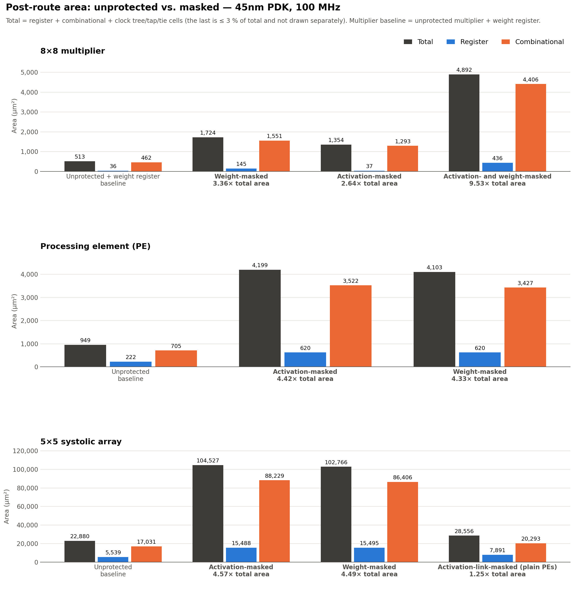
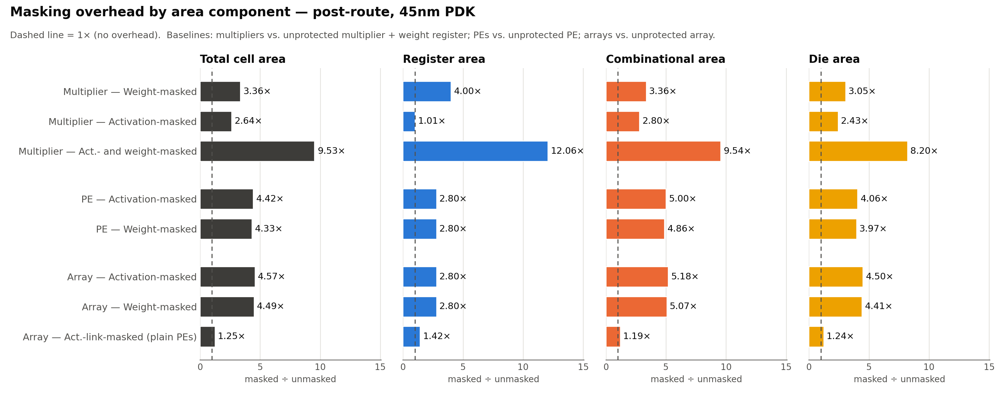

# Area Overhead of Arithmetic Masking — Post-Route Analysis

**Technology:** 45nm PDK, typical corner
**Flow:** Yosys 0.69+75 → OpenROAD 26Q3-2361 (floorplan → place → CTS → global/detailed route → RCX) → OpenSTA 3.1.0 sign-off
**Clock:** 100 MHz (10 ns) — quick timing sanity check only
**Metric:** post-route area (µm²): total standard-cell area, split into register
(flip-flop) and combinational area, plus total die area. Power is out of scope.

---

## 1. Summary

**Area definitions** (all post-route; filler cells excluded):
- **Register:** flip-flops.
- **Combinational:** every logic cell that is not a flip-flop, including buffers
  and inverters.
- **Total:** register + combinational + clock-tree, tap and tie cells. This is the
  full standard-cell area of the routed design.
- **Die:** full chip footprint at the common 50 % utilisation target.

| Level | Unmasked total (µm²) | Masked total (µm²) | **Total ×** | Register (µm²) unmasked → masked | **Register ×** | Combinational (µm²) unmasked → masked | **Comb. ×** | Die (µm²) unmasked → masked | **Die ×** |
|---|---:|---:|---:|---:|---:|---:|---:|---:|---:|
| 8×8 multiplier — activation-masked ¹ | 513.4 | 1,353.9 | **2.64×** | 36.2 → 36.7 | **1.01×** | 462.0 → 1,293.3 | **2.80×** | 1,265 → 3,075 | **2.43×** |
| 8×8 multiplier — weight-masked ¹ | 513.4 | 1,723.7 | **3.36×** | 36.2 → 144.7 | **4.00×** | 462.0 → 1,551.0 | **3.36×** | 1,265 → 3,859 | **3.05×** |
| 8×8 multiplier — act + weight masked ¹ | 513.4 | 4,891.7 | **9.53×** | 36.2 → 436.2 | **12.06×** | 462.0 → 4,406.0 | **9.54×** | 1,265 → 10,374 | **8.20×** |
| Processing element (act-masked) | 948.8 | 4,198.8 | **4.42×** | 221.6 → 619.5 | **2.80×** | 704.6 → 3,521.8 | **5.00×** | 2,200 → 8,932 | **4.06×** |
| 5×5 systolic array (act-masked) | 22,880.3 | 104,527.4 | **4.57×** | 5,539.4 → 15,487.9 | **2.80×** | 17,030.9 → 88,228.7 | **5.18×** | 46,386 → 208,502 | **4.50×** |
| Processing element (weight-masked) | 948.8 | 4,103.3 | **4.33×** | 221.6 → 619.5 | **2.80×** | 704.6 → 3,426.9 | **4.86×** | 2,200 → 8,737 | **3.97×** |
| 5×5 systolic array (weight-masked) | 22,880.3 | 102,766.4 | **4.49×** | 5,539.4 → 15,494.8 | **2.80×** | 17,030.9 → 86,406.4 | **5.07×** | 46,386 → 204,734 | **4.41×** |
| 5×5 systolic array (activation-link-masked, plain PEs) ² | 22,880.3 | 28,555.6 | **1.25×** | 5,539.4 → 7,890.9 | **1.42×** | 17,030.9 → 20,293.1 | **1.19×** | 46,386 → 57,442 | **1.24×** |

¹ The multiplier baseline is the unmasked Baugh-Wooley multiplier **plus its weight
register** (`bw_multiplier_wreg`), because every masked multiplier stores its weight
(shares) internally. Against the bare, purely combinational `baugh_wooley_multiplier`
(438.6 µm² total, no registers), the total-area ratios are 3.09× / 3.93× / 11.15×.

² `systolic_array_actlink_masked` keeps the 25 **unmodified** `processing_element`s
(plain multipliers) and masks only the west→east activation links between them. It
includes its own mask generator (`act_masker`, 8-bit shares). Each PE's multiplier
still sees the recombined plaintext activation, so this design protects less than
the fully masked arrays (§4.5).

Combinational logic accounts for most of the overhead everywhere. Registers grow
only where the stored state becomes wider:
- **Activation-masked multiplier:** the 8-bit weight register is unchanged (1.01×).
- **Masked PEs and arrays:** 2.80×. The activation-masked PE stores 32-bit
  activation and partial-sum shares; the weight-masked PE stores 32-bit weight and
  partial-sum shares. Both come to 137 flip-flops.
- **Activation-link-masked array:** 1.42×, from the mask generator's RNG state and
  the 8-bit share registers on the links.
- **Weight-masked multipliers:** 4.0× and 12×, from 16-bit weight shares and the
  registered term outputs.

Activation masking and weight masking cost almost the same at PE and array level:
- **PE:** 4.42× vs 4.33×.
- **Array:** 4.57× vs 4.49×.

Both duplicate the same datapath, two 8×32 share multipliers and two 32-bit
partial-sum chains (§4.3).

Masking only the activation links (plain PEs) is far cheaper: 1.25× total area
versus about 4.5× for the fully masked arrays. It leaves each PE's multiplier
working on plaintext activations (§4.5).

Die area tracks total area. It is slightly lower for the small designs because the
2 µm core margin weighs less as the die grows.

All 13 designs close timing at 100 MHz with ≥ 4.6 ns setup slack and positive hold
slack. All 13 route with **0 DRC violations**.





---

## 2. Designs under test

Parameters match the configurations used by the design testbenches
(`protected_designs/sim`, `sim`).

| Name | Top module | Source | Parameters | What it is |
|---|---|---|---|---|
| `mult_unmasked` | `baugh_wooley_multiplier` | `source/multiplier.sv` | N=8 | Unprotected signed 8×8 BW multiplier, combinational only |
| `mult_unmasked_wreg` | `bw_multiplier_wreg` | + `rtl/area_ref_wrappers.sv` | N=8 | The same multiplier plus an 8-bit stationary weight register (like-for-like reference) |
| `mult_wt_masked` | `masked_weight_multiplier` | `protected_designs/source/masked_wt_multiplier.sv` | N=8, SW=16 | Weight held as 2 arithmetic shares with refresh; 2 × `share_multiplier` (8×16) |
| `mult_act_masked` | `masked_act_multiplier` | `masked_act_multiplier.sv` | N=8, SW=16 | Plain weight register; activation arrives as 2 shares; 2 × `share_multiplier` (8×16) |
| `mult_act_wt_masked` | `masked_multiplier_aw` | `masked_act_wt_multiplier.sv` | N=8, SW=16 | Both operands shared: 4 × `share_multiplier` (16×16 mod 2¹⁶), blinded cross terms, output registers |
| `pe_unmasked` | `processing_element` | `source/processing_element.sv` | N=8, ACCW=32 | Weight-stationary PE |
| `pe_act_masked` | `processing_element_masked_act` | `processing_element_masked_act.sv` | N=8, SHARE_W=32 | PE with 2-share activation and partial-sum datapaths |
| `sa_unmasked` | `systolic_array` | `source/systolic_array.sv` | 5×5, N=8, ACCW=32 | 25 × `processing_element` |
| `sa_act_masked` | `systolic_array_masked_act` | `systolic_array_masked_act.sv` | 5×5, N=8, SHARE_W=32 | 25 × `processing_element_masked_act` |
| `act_masker` | `act_masker` | `act_masker.sv` | 5 rows, SHARE_W=32 | West-boundary share generator (xorshift64 RNG + splitter per row) |
| `sa_actlink_masked` | `systolic_array_actlink_masked` | `systolic_array_actlink_masked.sv` + `source/processing_element.sv`, `source/multiplier.sv`, `act_masker.sv` | 5×5, N=8, ACCW=32, SHARE_W=8 (RTL defaults, as in its testbench) | 25 unmodified PEs; activations travel between PEs as two 8-bit shares (`act_link_masked` registers) and are recombined at each PE input; includes `act_masker` |
| `pe_wt_masked` | `processing_element_masked` | `processing_element_masked_wt.sv` | N=8, SHARE_W=32 | PE with 2-share weights (stored and forwarded as two 32-bit shares) and 2-share partial sums; plain activation |
| `sa_wt_masked` | `systolic_array_masked` | `systolic_array_masked_wt.sv` | 5×5, N=8, SHARE_W=32 | 25 × `processing_element_masked` |

The wrapper in `rtl/area_ref_wrappers.sv` changes no design under test. It only adds
the weight register that a fair multiplier comparison would otherwise leave out.

The activation-masked array (`sa_act_masked`) does **not** include a mask generator:
its activation shares are module inputs. The cost of the generator is shown
separately in the `act_masker` row.

---

## 3. Results

### 3.1 Total, register, combinational and die area

| Level | Design | Total (µm²) | Register (µm²) | Comb. (µm²) | Clock/tap/tie (µm²) | Die (µm²) | Total × | Register × | Comb. × | Die × |
|---|---|---:|---:|---:|---:|---:|---:|---:|---:|---:|
| Multiplier | Unmasked (combinational only) | 438.6 | 0.0 | 428.0 | 10.6 | 1,106 | — | — | — | — |
| Multiplier | Unmasked + weight reg (**baseline**) | 513.4 | 36.2 | 462.0 | 15.2 | 1,265 | — | — | — | — |
| Multiplier | Weight-masked | 1,723.7 | 144.7 | 1,551.0 | 27.9 | 3,859 | 3.36× | 4.00× | 3.36× | 3.05× |
| Multiplier | Activation-masked | 1,353.9 | 36.7 | 1,293.3 | 23.9 | 3,075 | 2.64× | 1.01× | 2.80× | 2.43× |
| Multiplier | Activation + weight masked | 4,891.7 | 436.2 | 4,406.0 | 49.5 | 10,374 | 9.53× | 12.06× | 9.54× | 8.20× |
| PE | Unmasked (**baseline**) | 948.8 | 221.6 | 704.6 | 22.6 | 2,200 | — | — | — | — |
| PE | Activation-masked | 4,198.8 | 619.5 | 3,521.8 | 57.5 | 8,932 | 4.42× | 2.80× | 5.00× | 4.06× |
| Systolic array | Unmasked 5×5 (**baseline**) | 22,880.3 | 5,539.4 | 17,030.9 | 309.9 | 46,386 | — | — | — | — |
| Systolic array | Activation-masked 5×5 | 104,527.4 | 15,487.9 | 88,228.7 | 810.8 | 208,502 | 4.57× | 2.80× | 5.18× | 4.50× |
| PE | Weight-masked | 4,103.3 | 619.5 | 3,426.9 | 56.9 | 8,737 | 4.33× | 2.80× | 4.86× | 3.97× |
| Systolic array | Weight-masked 5×5 | 102,766.4 | 15,494.8 | 86,406.4 | 865.3 | 204,734 | 4.49× | 2.80× | 5.07× | 4.41× |
| Systolic array | Activation-link-masked 5×5 (plain PEs, incl. `act_masker`) | 28,555.6 | 7,890.9 | 20,293.1 | 371.6 | 57,442 | 1.25× | 1.42× | 1.19× | 1.24× |
| Support | `act_masker` alone (5 rows, 32-bit shares) | 4,809.0 | 1,447.0 | 3,259.8 | 102.1 | 10,098 | — | — | — | — |

Total = register + combinational + clock/tap/tie. Each × compares that component
with the same component of the baseline marked **baseline** in its level.

### 3.2 Detailed cell-class breakdown, timing and routing

| Design | Register | Comb. logic | Buf/Inv | Clock buf (CTS) | Tap/Tie | **Total** | Yosys (pre-layout) | Cells | Core util. | Setup WNS (ns) | Hold WNS (ns) | Route DRC |
|---|---:|---:|---:|---:|---:|---:|---:|---:|---:|---:|---:|---:|
| mult_unmasked | 0.0 | 408.8 | 19.1 | 0.0 | 10.6 | **438.6** | 428.0 | 407 | 53.9 % | +4.751 | +4.043 | 0 |
| mult_unmasked_wreg | 36.2 | 441.3 | 20.8 | 4.0 | 11.2 | **513.4** | 498.2 | 451 | 55.7 % | +4.811 | +0.142 | 0 |
| mult_wt_masked | 144.7 | 1,487.5 | 63.6 | 6.7 | 21.3 | **1,723.7** | 1,689.1 | 1,475 | 53.1 % | +4.647 | +0.135 | 0 |
| mult_act_masked | 36.7 | 1,240.6 | 52.7 | 4.8 | 19.1 | **1,353.9** | 1,323.6 | 1,220 | 52.4 % | +4.797 | +0.213 | 0 |
| mult_act_wt_masked | 436.2 | 4,212.6 | 193.4 | 12.8 | 36.7 | **4,891.7** | 4,787.7 | 3,945 | 51.8 % | +6.376 | +0.148 | 0 |
| pe_unmasked | 221.6 | 679.6 | 25.0 | 6.7 | 16.0 | **948.8** | 920.4 | 728 | 52.8 % | +5.973 | +0.140 | 0 |
| pe_act_masked | 619.5 | 3,349.5 | 172.4 | 23.4 | 34.0 | **4,198.8** | 4,096.1 | 3,502 | 51.9 % | +5.356 | +0.238 | 0 |
| sa_unmasked | 5,539.4 | 16,378.4 | 652.5 | 209.9 | 100.0 | **22,880.3** | 22,339.2 | 16,685 | 51.6 % | +5.987 | +0.107 | 0 |
| sa_act_masked | 15,487.9 | 83,775.4 | 4,453.4 | 510.2 | 300.6 | **104,527.4** | 102,433.1 | 85,470 | 51.2 % | +5.393 | +0.097 | 0 |
| pe_wt_masked | 619.5 | 3,287.8 | 139.1 | 23.4 | 33.5 | **4,103.3** | 4,002.5 | 3,375 | 52.1 % | +5.190 | +0.113 | 0 |
| sa_wt_masked | 15,494.8 | 82,850.5 | 3,555.9 | 567.6 | 297.6 | **102,766.4** | 100,565.6 | 82,990 | 51.3 % | +5.115 | +0.101 | 0 |
| sa_actlink_masked | 7,890.9 | 19,508.7 | 784.4 | 260.4 | 111.2 | **28,555.6** | 27,770.7 | 19,924 | 51.9 % | +5.925 | +0.098 | 0 |
| act_masker | 1,447.0 | 3,030.3 | 229.6 | 66.0 | 36.2 | **4,809.0** | 4,655.0 | 3,236 | 52.4 % | +4.737 | +0.116 | 0 |

- **Comb. logic + Buf/Inv** gives the combinational column of §3.1. "Buf/Inv" covers
  the buffers that repair_design and repair_timing insert, plus any buffers and
  inverters the logic mapper chose.
- **Clock buf + Tap/Tie** gives the clock/tap/tie column.
- **WNS values** come from standalone OpenSTA on the routed netlist with extracted
  SPEF.

---

## 4. Discussion

### 4.1 Multipliers: share width sets the cost, not the masking itself
- **Activation-masked (2.64×).** The weight register is unchanged (8 flops), so
  almost all of the overhead is combinational: two `share_multiplier`s at about
  620 µm² each, against 409 µm² for the 8×8 BW array. Each share is 16 bits wide,
  so every `share_multiplier` is an **8×16** array truncated mod 2¹⁶, about 1.5×
  the 8×8 array. Two of them give about 3×.
- **Weight-masked (3.36×).** It contains the same two 8×16 share multipliers. On top
  of those come two 16-bit share registers (32 flops instead of 8; sequential area
  goes from 36 to 145 µm², 4.0×) and the refresh subtractor and adder, which add
  about 250 µm² of combinational logic.
- **Activation + weight masked (9.53×).** Both operands are 16-bit shares, so the
  design needs **four** 16×16 mod 2¹⁶ products: two inner terms and two cross terms.
  It also needs the refresh logic, two blinding adders, two compression adders and
  96 flops (weight shares plus the four term registers). Combinational area alone
  is about 9.5× the baseline.
- None of these numbers include the **randomness sources** (`r_refresh`,
  `r_cross`, activation-share generation). Those are module inputs here. In a full
  design they come from an RNG; at the array level that RNG is `act_masker`
  (§4.4).

### 4.2 Processing element (total 4.42× / register 2.80× / comb. 5.00×)
- **Combinational: 704.6 → 3,521.8 µm² (5.00×).** The masked PE carries two
  `share_multiplier`s with **32-bit** shares (SHARE_W = ACCW = 32), each an 8×32
  array mod 2³², instead of one 8×8 array. It also has two 32-bit partial-sum
  adders instead of one.
- **Register: 221.6 → 619.5 µm² (2.80×).** Flop count goes from 49 to 137
  (8 weight + 2×32 activation shares + 2×32 psum shares + 1 valid). The activation
  pipeline register also grows from 8 to 64 bits, because shares are 32 bits wide
  rather than 8.
- The 32-bit share width is the main cost driver. The design notes say SHARE_W ≥ 18
  is enough for a 5-row column. A narrower SHARE_W would shrink both share
  multipliers and every share register and adder roughly in proportion. That
  trade-off has not been measured here.

### 4.3 Weight-masked vs. activation-masked PE and array
- **Same datapath cost.** Both PEs duplicate the multiply-accumulate datapath into
  two share domains: two `share_multiplier`s (8×32, mod 2³²) and two 32-bit
  partial-sum adders. The only difference is which operand is shared. The
  weight-masked PE multiplies the plain 8-bit activation by a 32-bit weight share;
  the activation-masked PE multiplies the plain 8-bit weight by a 32-bit activation
  share.
- **Identical register area: 619.5 µm², 137 flip-flops each.**
  - Weight-masked: 2×32 weight shares + 8 activation + 2×32 psum + 1 valid.
  - Activation-masked: 8 weight + 2×32 activation shares + 2×32 psum + 1 valid.

  The 32-bit share register just moves from the activation pipeline to the weight
  shift chain.
- **Combinational area is 2.7 % lower for the weight-masked PE** (3,426.9 vs
  3,521.8 µm²): 62 µm² less logic and 33 µm² fewer buffers/inverters. The likely cause is a synthesis
  difference rather than an architectural one. The activation-masked PE marks its
  two share multipliers `keep_hierarchy`, which blocks optimisation across their
  boundaries. The weight-masked RTL as supplied does not, so Yosys flattens it
  completely. A gap this small is close to the ±2 % mapping noise.
- **Array level:** 102,766 µm² (4.49×) for weight-masked against 104,527 µm²
  (4.57×) for activation-masked, a 1.7 % difference with the same register area.
- **Randomness and refresh, for a fair deployed comparison:**
  - The activation-masked array needs a mask generator running every cycle. It is
    not included in the array numbers; standalone, `act_masker` with 32-bit shares
    is 4,809 µm², about 4.6 % of the masked array.
  - The weight-masked array gets its weight shares once per tile load, so share
    generation sits outside the array and is not counted.
  - This weight-masked PE has **no share refresh**. The shares stay constant for a
    whole tile, unlike `masked_weight_multiplier`, whose own comments note that
    refresh guards against per-share CPA. Adding refresh would add a 32-bit
    subtractor/adder pair per PE (about 250 µm² at 16 bits in the multiplier case,
    §4.1) plus a refresh RNG. The weight-masked numbers here are therefore a lower
    bound for a refreshed design.

### 4.4 Fully masked systolic arrays (act-masked: total 4.57× / register 2.80× / comb. 5.18×; weight-masked: 4.49× / 2.80× / 5.07×)
- The array overhead tracks the PE overhead. Each routed array is within 4 % of 25
  standalone PEs:

  | Array | 25 × standalone PE (µm²) | Routed array (µm²) |
  |---|---:|---:|
  | Unmasked | 23,720 | 22,880 |
  | Activation-masked | 104,970 | 104,527 |
  | Weight-masked | 102,583 | 102,766 |

  The small differences come from one shared clock tree and the I/O buffering that
  standalone PEs get but internal array nets don't. Masking therefore adds no
  array-level cost beyond the per-PE cost.
- The mask generator `act_masker` (one 64-bit xorshift RNG and a 32-bit splitter per
  row) is 4,809 µm² standalone, about +0.21× of the unmasked array. It is a per-row
  cost, so it shrinks relative to the array as COLS grows.

### 4.5 Activation-link-masked array, plain PEs (total 1.25× / register 1.42× / comb. 1.19×)
- **What it is.** `systolic_array_actlink_masked` keeps the 25 unmodified
  `processing_element`s. Masking lives only in the array:
  - `act_masker` splits each row's activation into two 8-bit shares.
  - `act_link_masked` registers carry the shares from column to column.
  - An 8-bit adder recombines them right before each PE's `act_in`.

  The PEs' own `act_out` registers are left unconnected, so synthesis removes them.
- **Total area 28,556 µm², +5,675 µm² over the unprotected array (1.25×).** This is
  about a quarter of the fully masked arrays' cost (about 4.5×).
- **Register: 5,539 → 7,891 µm² (1.42×).** The flop count goes from 1,225 to 1,745,
  which matches the RTL exactly:
  - +320 RNG state bits (5 rows × 64-bit xorshift)
  - +400 link share registers (5 rows × 5 links × 2 × 8 bits)
  - −200 removed PE `act_out` registers (25 × 8)
- **Combinational: 17,031 → 20,293 µm² (1.19×).** The additions are the xorshift
  update logic, five 8-bit share splitters, and thirty 8-bit recombine adders (six
  links per row). The 25 multipliers and psum adders are unchanged.
- **Why it is cheap, and what it does not cover.** It never duplicates the
  multiplier or the 32-bit partial-sum datapath, which are what make the fully
  masked arrays about 4.5×. The flip side is that each PE's multiplier still
  computes on the **plaintext** activation, and the partial sums stay unmasked.
  Only the activation transport between PEs is protected. The 1.25× buys a
  narrower protection scope than the 4.5× designs, and this report measures area
  only, not that security difference.

### 4.6 Physical-design effects
- Post-route area is only 2.0–3.3 % above the Yosys estimate. The difference is
  timing and design repair buffers, CTS buffers, and tap cells. At 100 MHz no
  design needs significant upsizing, so the ratios at post-synthesis and
  post-route agree to within about 1 % (e.g. PE 4.45× post-synthesis vs. 4.42×
  post-route).
- Clock-tree area grows with flop count. In the masked array it is 2.4× the
  baseline (510 vs 210 µm²).

### 4.7 Timing at 100 MHz
Every design meets 10 ns with ≥ 4.6 ns setup slack. The worst masked path is about
5.1 ns of data arrival (weight-masked array). The 2 ns input delay is
included where a path starts at a port. At this frequency masking costs area,
not timing closure.

---

## 5. Methodology

1. **Synthesis (`scripts/synth.tcl`).** `synth -flatten`, then `dfflibmap` and
   `abc -D 10000`, mapping to the 45nm PDK typical library with the platform `DONT_USE`
   cells. Flattening keeps every instance marked `keep_hierarchy`, so the
   per-share `share_multiplier`s stay separate modules. Yosys therefore cannot
   merge or share logic across share domains, which is the cost the RTL intends.
   The unmasked designs are fully flattened and optimised.
2. **Floorplan.** Every design uses the same 50 % core utilisation target, aspect
   ratio 1, and 2 µm core margin. Area differences therefore come from the logic,
   not from floorplan choices. Die and core area follow from the target
   utilisation, so they are **not** used as the metric (they are listed in
   `results/area_results.csv`).
3. **Place and route (`scripts/pnr.tcl`).** Tap and endcap cells, then the PDN
   (metal1 rails plus metal4 straps; the strap pitch is scaled to the die because
   the platform's 56 µm and 30 µm straps are larger than the small multiplier
   dies). Then IO placement, global placement (density 0.60), repair_design, CTS
   (`CLKBUF_X1/X2/X3`), repair_timing, global route with post-GRT repair, filler
   insertion, and detailed route.
4. **Area measurement.** The routed OpenDB is walked and every instance's master
   area is summed by class. **Filler cells are excluded.** Tap, tie, buffer and CTS
   cells are included, since they are real silicon the design needs. The total
   matches OpenROAD's own `report_design_area` for every design (see
   `openroad.log`).
5. **Timing.** RC extraction with the platform `rcx_patterns.rules` writes SPEF.
   Standalone **OpenSTA** then reads the routed netlist and SPEF with propagated
   clocks (`scripts/sta_postroute.tcl`).
6. **Constraints (`constraints/constraints.sdc`).** 10 ns clock. Input and output
   delays are 20 % of the period, inputs are driven by `BUF_X2`, and outputs carry
   a 5 fF load. The bare combinational multiplier uses a virtual clock so its
   input-to-output path is checked against the same budget.

### Caveats
- This is a single-corner (typical) result from one tool run, and mapping noise is
  about ±2 %. Treat it as a relative comparison, not a sign-off PPA report.
- Randomness generation is excluded from the multiplier, PE and fully masked array
  rows, where the shares are inputs. It is included in the activation-link-masked
  array, which contains its own `act_masker`. Weight-share generation (once per
  tile load) is outside the weight-masked array and not counted.
- `processing_element_masked_wt.sv` and `systolic_array_masked_wt.sv` were
  synthesised exactly as supplied. Unlike the activation-masked PE, their share
  multipliers carry no `keep_hierarchy`, so Yosys may optimise across the two share
  domains (§4.3).
- OpenROAD links the netlist flat. The share domains are therefore logically
  separate but can be placed next to each other. That has no effect on area, but it
  matters for physical leakage, which is out of scope here.
- Tool workaround: in the installed Yosys dev build, `chparam` and
  `hierarchy -chparam` hit an internal assertion on the array tops. All three
  array tops are therefore elaborated with their RTL defaults, which are already the intended
  configuration (5×5, N=8; SHARE_W=32 for the fully masked arrays, SHARE_W=8 for
  the activation-link-masked array, matching its testbench).

---

## 6. Reproducing

```bash
cd area_overhead_analysis
scripts/run_all.sh                    # all designs in parallel, then table + plots
# or one design:
scripts/run_design.sh pe_act_masked
python3 scripts/collect_metrics.py    # -> results/area_results.csv, results/area_tables.md
python3 scripts/plot_area.py          # -> results/area_postroute.png, results/area_overhead.png
```

`PLATFORM_DIR` defaults to `~/OpenROAD-flow-scripts/flow/platforms/nangate45`.
The small designs finish in seconds to a couple of minutes. The two masked
arrays dominate the runtime, at roughly 10–20 minutes each on this machine.

### Directory layout
```
area_overhead_analysis/
├── REPORT.md                     this report
├── constraints/constraints.sdc   100 MHz constraints
├── rtl/area_ref_wrappers.sv      like-for-like multiplier reference (no DUT changes)
├── scripts/
│   ├── designs.sh                design matrix (name | top | files | params)
│   ├── run_design.sh / run_all.sh
│   ├── synth.tcl                 Yosys
│   ├── pnr.tcl                   OpenROAD (P&R + area extraction)
│   ├── sta_postroute.tcl         OpenSTA sign-off
│   ├── collect_metrics.py        -> CSV + markdown tables
│   └── plot_area.py              -> PNG plots
└── results/
    ├── area_results.csv, area_tables.md, area_postroute.png, area_overhead.png
    └── <design>/                 synth_stat.rpt, netlists, postroute_metrics.txt,
                                  report_cell_usage.rpt, sta_postroute.rpt, logs
                                  (*.odb / *.def / *.spef are git-ignored)
```
